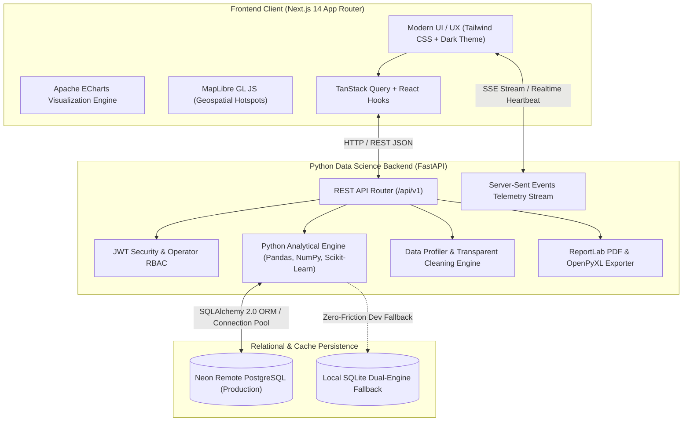
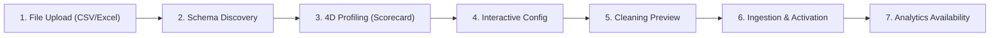

# SYSTEM ARCHITECTURE & TECHNICAL SPECIFICATION
## TRAFFIC TREND — Road Safety Intelligence & Accident Analytics Platform
*Version: 2.0.0 | Academic & Production Standard*

---

## 1. High-Level System Architecture

The **TRAFFIC TREND** platform separates interactive presentation, high-performance API orchestration, scientific computation, and relational persistence into decoupled tiers.

---

## 2. Component Design & Responsibility Matrix

### 2.1 Frontend Architecture (`frontend/`)
- **Framework:** Next.js 14 App Router with React 18 and TypeScript.
- **Styling & Theme:** Tailwind CSS with a custom deep midnight navy (`#080c14` / `#0f172a`), neon cyan (`#06b6d4`), electric blue (`#3b82f6`), amber (`#f59e0b`), and critical hazard red (`#ef4444`).
- **Interactive Visualizations:**
  - **Apache ECharts:** Multi-year line/bar trajectories, doughnut severity distributions, monthly seasonality bars, and 2D Day-Hour 168-hour collision density heatmaps.
  - **MapLibre GL JS:** Interactive geospatial rendering with dark Carto tiles, severity-coded pins, cluster inspection, and coordinates popup tooltips.
- **Client State & API Client:** Strongly typed API layer in `services/api.ts` with transparent authentication header injection, error handling, and parameter serialization.

### 2.2 Backend Architecture (`backend/`)
- **Web Framework:** FastAPI with asynchronous ASGI execution on Uvicorn.
- **Data Science Engine:** Vectorized Pandas and NumPy data processing pipelines. Python performs 100% of analytical, KPI, risk, and anomaly computations.
- **Relational Persistence:** SQLAlchemy 2.0 with connection pooling, automatic failover, and Alembic migrations.
- **Document Generation:**
  - **ReportLab:** Printable executive briefs with embedded tables, KPI scorecards, and methodology disclosures.
  - **OpenPyXL:** Multi-tab analytical Excel workbooks with custom styles, frozen headers, and formatted numerical columns.
- **System Monitoring:** Dedicated health monitor with real-time database query latency auditing, storage volume inspection, and live Server-Sent Events (SSE).

---

## 3. Transparent Data Ingestion & Quality Lifecycle

1. **File Upload:** Ingests raw files into `data/raw/` preserving raw byte provenance.
2. **Schema Discovery:** Dynamically maps user column nomenclature to the 24-dimension canonical schema.
3. **4-Dimensional Profiling:** Evaluates Completeness (30%), Uniqueness (25%), Validity (25%), and Consistency (20%), generating an overall score (0–100) and letter grade (A–D).
4. **Interactive Configuration:** Analyst toggles deduplication, coordinate bounds sanitization, and casualty non-negativity rules.
5. **Cleaning Preview:** Computes transformation audit summary before altering persistent records.
6. **Persistence & Activation:** Saves cleaned parquet to `data/processed/`, batch-inserts records into PostgreSQL, updates metadata, and makes the dataset live.

---

## 4. Security & Access Control Model

- **Hybrid Operational Model:**
  - Public access is granted for exploration of analytical dashboards, trends, maps, severity, risk intelligence, and report downloads.
  - Administrative privileges (JWT Bearer Token signed with HMAC-SHA256) are strictly required for dataset uploads, cleaning pipeline execution, and dataset deletion.
- **Password Security:** Salted hashing with `bcrypt` / SHA-256 fallback.
- **CORS Protection:** Configurable whitelist restricting browser access to trusted frontends (`http://localhost:3000`).
